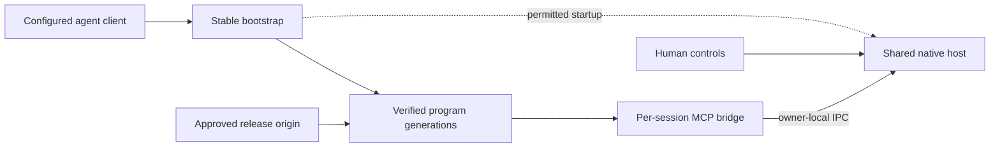

# Distribution and compatibility

Accepted direction; implementation pending. The Node/npm bootstrap and independent API negotiation are approved for implementation. Current source requires a running native host and has no published bootstrap package, update channel, or release installation workflow.

## Recipient setup

Provide a stable MCP entry through a small Node/npm bootstrap, with Node 24 or newer. The intended package is `@inherent-design/re-desktop`; it is not published yet. Retain standalone native operation with the bundled runtime. Recipients need no checkout, compiler, Bend installation, or Lean installation.

Initial setup prefetches and verifies the selected native release, then prints MCP configuration or applies only the requested client change. Warm startup uses verified bytes without a network dependency. A cold invocation without a payload must acquire it within a bounded startup budget or fail clearly. A missing exact release never becomes an arbitrary version fallback.

Initial qualified native targets are macOS arm64, Windows x64, and Linux x64. Additional targets need executed qualification. Native payloads include the application, MCP bridge, compiled Bend core, dependencies, and runtime.

## API boundaries

| Contract | Owner | Compatibility requirement |
| --- | --- | --- |
| Standard MCP wire protocol | MCP SDK and client | Standard MCP negotiation |
| Agent application API | Tools, schemas, and agent guidance | Independent of native UI versions |
| Host application API | Native controls, settings, and user behavior | Independent of agent tool versions |
| Shared IPC API | Bridge/host requests, snapshots, capabilities, and errors | Common supported version before subscription or mutation |

Product-version equality is not compatibility. Components with independent individual APIs can cooperate when a shared IPC version and required capabilities overlap. Reject unsupported or malformed negotiation without mutating access. Report the component needing an upgrade where determinable, including legacy components lacking negotiation.

Preparation follows an owner-selected release policy. Agents cannot supply arbitrary download URLs, signing keys, shell commands, or trust policy. An initialized MCP connection stays pinned to its implementation; an incompatible upgrade requires a new connection. A compatible host does not need an upgrade merely because its release number differs.

## Bootstrap and native host

Prefer loading a Node-compatible bridge into the bootstrap's session process. External Node cannot assume Electron ASAR support; the release needs an appropriate bridge payload. A separate child requires parent-death and EOF tests. The shared tray outlives individual agents and must not inherit their MCP stdio handles.

Read-only discovery/status does not launch or update the host. Preparation or first subscription can start one visible host per user/profile under the configured policy. Concurrent clients must converge on an authenticated readiness handshake. Headless or unsupported desktop sessions report actual availability.

A fresh host starts paused. Runtime readiness does not grant access, and no MCP management operation clears human pause. Deliberate Quit prevents immediate automatic respawn. Crash recovery can restart under the configured policy, still paused. Retain explicit 30-second access expiry for a bridge kept alive by its agent runtime.

## Program store and updates

Keep admitted generations in per-user application data, separately from disposable downloads and session state. Use exact release digests and targets, owned candidates, bounded acquisition, a short-lived writer lock, and atomic readiness. Validate version, protocol, target, final bytes, and the available publisher/OS trust basis before execution. Checksums from the same HTTPS origin are not independent publisher signatures.

Validate the complete native bundle. Reject path escapes and ambiguous members while preserving required internal framework links and executable attributes. Electron payloads exceed empack's single-engine archive limits; derive bounds from measured inventories. Explicit development overrides stay outside release slots.

Support exact pins first. An enrolled stable channel can later check/stage compatible releases, with activation at an eligible cold start. Bootstrap updates stay with their package/installer owner. Development channels require opt-in and intentional prerelease publication, rather than every push to dev.

Retain active, staged, and prior verified generations. Do not overwrite files under live processes or restart a host serving sessions. A coordinated operator restart ends access and creates fresh identities. Rollback preserves user settings and never restores leases. Offline reuse follows the saved policy with freshness qualified. Cleanup is limited to owned inactive material.

## Release pipeline

1. Qualify substantial work on dev, then main. Stable releases use qualified main; prereleases identify their exact qualified source.
2. Compile/prove Bend once and record source/output provenance. Package every target from those bytes. Apply signing, notarization, and installer policy before calculating final digests.
3. Coordinate one draft GitHub Release and upload packages directly from tag-only jobs. Keep branch/PR workflows credential-free and avoid large Actions artifacts as the release rendezvous.
4. Verify the complete expected inventory, source/target/API identities, digests, and signatures. Exercise actual downloaded packages, including their MCP entry.
5. Publish only a complete qualified release, then any channel pointer last. Failure leaves the previous selection intact. Identical retries are idempotent; changed bytes under an immutable identity are refused.

The release description binds source revision, product/bootstrap compatibility, independent APIs, shared IPC capabilities, platform constraints, compiled-core provenance, asset sizes/digests, and fixed entry points. It contains no recipient credentials or arbitrary executable-selection commands.

Public delivery must be tested without publisher credentials. Private previews require configured reader access. Attach the npm tarball to the GitHub Release as well as publishing it to npm. An unsigned preview must be identified as such and does not qualify signed production delivery.

## Platform requirements

Linux may need a supported installer for Chromium sandbox ownership and desktop indicator support. An unprivileged extractor cannot establish root ownership; report installation requirements rather than disabling sandboxing or initiating elevation. Xvfb construction is not GNOME/KDE visibility evidence.

Electron's built-in updater supports macOS and Windows, subject to signing and installer format. A portable program store does not remove OS requirements. The current packaged MCP entry depends on Electron's RunAsNode fuse; disabling it requires a different runtime arrangement and another packaged check.

Homebrew, winget, and Linux repositories can use the same release identities. Define one update owner per installation so package-manager and application updates do not race.

## Qualification

Exercise cold setup, warm/offline reuse, unsupported targets/APIs, bad digests, corrupt cache, interrupted publication, and concurrent acquisition. Verify native paths and application links. Test real desktop startup, pause, deliberate Quit, per-session teardown, deferred updates, rollback, and local installation from published artifacts.

The [verification record](verification.md) distinguishes executed checks from these requirements.

## References

- [Electron autoUpdater](https://www.electronjs.org/docs/latest/api/auto-updater)
- [Electron fuses](https://www.electronjs.org/docs/latest/tutorial/fuses)
- [GitHub Releases](https://docs.github.com/en/repositories/releasing-projects-on-github/about-releases)
- [npm exec](https://docs.npmjs.com/cli/v11/commands/npm-exec/)

Empack's bootstrap informed exact engine selection, admitted cache reuse, compatibility probes, literal arguments, and lifecycle handling. Its exact-version bootstrap and separately governed content channels do not establish an automatic latest-version policy for this application.
