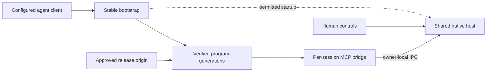

# Distribution and compatibility

The Node/npm bootstrap selects exact native releases, verifies cached program generations, and loads a per-session MCP bridge. The shared visible tray can start on subscription or preparation and always starts paused. Source mode still requires manual native startup. This document describes implemented preview delivery; automatic channels, signed stable releases, and package-manager installers remain future work.

## Recipient setup

The stable MCP entry is the small `@inherent.design/re-desktop` npm bootstrap, with Node 24 or newer. `re-desktop setup` prepares its exact native selection and prints client configuration. Standalone native operation uses the bundled runtime. Recipients need no checkout, compiler, Bend installation, or Lean installation.

Setup prefetches and verifies the selected native release, then prints JSON client configuration without changing client settings. `config` prints the same literal absolute Node/CLI arguments without acquisition. `prefetch` prepares without selecting. `setup --version <exact-version>` changes the pin for new connections; `--offline` forbids acquisition. Warm startup uses verified bytes without a network dependency. A cold invocation without a payload must acquire it within a bounded startup budget or fail clearly. A missing exact release never becomes an arbitrary version fallback.

Initial qualified native targets are macOS arm64, Windows x64, and Linux x64. Additional targets need executed qualification. Native payloads include the application, MCP bridge, compiled Bend core, dependencies, and runtime.

## API boundaries

| Contract | Owner | Compatibility requirement |
| --- | --- | --- |
| Standard MCP wire protocol | MCP SDK and client | Standard MCP negotiation |
| Agent application API | Tools, schemas, and agent guidance | Independent of native UI versions |
| Host application API | Native controls, settings, and user behavior | Independent of agent tool versions |
| Shared IPC API | Bridge/host requests, snapshots, capabilities, and errors | Common supported version before subscription or mutation |

Product-version equality is not compatibility. Components with independent individual APIs can cooperate when a shared IPC version and required capabilities overlap. Reject unsupported or malformed negotiation without mutating access. Report the component needing an upgrade where determinable, including legacy components lacking negotiation.

Preparation follows an owner-selected release policy. Agents cannot supply arbitrary download URLs, signing keys, shell commands, or trust policy. An initialized MCP connection stays pinned to its implementation; an incompatible upgrade requires a new connection. A compatible host does not need an upgrade merely because its release number differs.

## Bootstrap and native host

The bootstrap loads its verified Node-compatible bridge into the session process. External Node cannot assume Electron ASAR support; releases include an external `bridge/` payload. The shared tray outlives individual agents and must not inherit their MCP stdio handles.

Read-only discovery/status does not launch or update the host. Preparation or first subscription can start one visible host per user/profile under the configured policy. Concurrent clients must converge on an authenticated readiness handshake. Headless or unsupported desktop sessions report actual availability.

A fresh host starts paused. Runtime readiness does not grant access, and no MCP management operation clears human pause. Deliberate Quit prevents immediate automatic respawn. Crash recovery can restart under the configured policy, still paused. Retain the explicit 15-minute holder heartbeat for a bridge kept alive by its agent runtime. Automatic transport presence has its own 30-second grace.

The three-mode contract declares agent API `2.0.0`, host API `2.0.0`, and shared IPC `[3]`, including `pause-after`, `heartbeat-warnings`, and `session-cleanup` capabilities. Shared API 1/2 peers are rejected with an upgrade diagnostic before mutation. The bootstrap accepts IPC 3 native manifests only. Updating npm does not alter an existing native pin or running bridge; select the exact new release, then reconnect and perform an operator-controlled idle host restart when required. Never force-replace an active host to satisfy negotiation.

Codex integration settings and per-thread cleanup capabilities live in the private runtime profile, outside immutable program generations. `codex-install` is an operator action and configures only the named `re_desktop` entry and its cleanup hooks. A mise launcher uses `mise -C <owner-home> exec -- re-desktop mcp`; direct installation records absolute Node/bootstrap paths. Review integration again after moving a direct installation. [Protocol](protocol.md#codex-integration) owns endpoint, hook trust and removal details.

## Program store and updates

Admitted generations live in per-user application data: `~/Library/Application Support/re-desktop/programs` on macOS, `%LOCALAPPDATA%/re-desktop/programs` on Windows, and `$XDG_DATA_HOME/re-desktop/programs` or `~/.local/share/re-desktop/programs` on Linux. Each exact version/target contains a ready receipt and program tree. `selection.json` records the owner pin. Downloads use private candidate directories in this store and are removed after admission or a caught failure. Runtime state stays separate in `~/.re-desktop`. `RE_DESKTOP_STORE` and `RE_DESKTOP_RUNTIME` provide explicit owner/test overrides. Acquisition uses the fixed `inherent-design/re-desktop` origin, exact published tags, owned candidates, a writer lock, and atomic readiness. Metadata is bounded to 1 MiB; compressed assets to 512 MiB; expanded archives to 2 GiB and 20,000 members. Private previews use an existing gh credential helper, without copying credentials. Network requests and writer waits are bounded. Setup before MCP configuration avoids a cold download during a client startup timeout. Validate version, protocol, target, final bytes, and the available publisher/OS trust basis before execution. Checksums from the same HTTPS origin are not independent publisher signatures.

Admission checks the manifest source/version/target/APIs, asset size/SHA-256, archive paths/member kinds/links, and fixed bridge/native entry identities. Warm reuse rechecks the full regular-file hashes, links, and executable attributes against the admitted receipt. Corruption is refused; it does not silently replace a live generation. Repair an owned stopped generation or select a different exact release. Crashed candidates can remain as inactive material; they never become ready. Reject path escapes and ambiguous members while preserving required internal framework links and executable attributes. The first local macOS payload measured about 124 MiB compressed, including its external Node bridge; empack's smaller engine limit would reject it. Explicit development overrides stay outside release slots.

Exact pins are implemented. An enrolled stable channel is future work; there is no automatic latest-version selection. Bootstrap updates stay with their package/installer owner. Development channels require opt-in and intentional prerelease publication, rather than every push to dev.

Prepared and prior verified generations are retained; automatic garbage collection is not implemented. Do not overwrite files under live processes or restart a host serving sessions. A coordinated operator restart ends access and creates fresh identities. Rollback preserves user settings and never restores leases. Offline reuse follows the saved policy with freshness qualified. Cleanup is limited to owned inactive material.

## Release pipeline

1. Qualify substantial work on dev, then main. Stable releases use qualified main; prereleases identify their exact qualified source.
2. Compile/prove Bend once and record source/output provenance. Package every target from those bytes. Apply signing, notarization, and installer policy before calculating final digests.
3. Coordinate one draft GitHub Release and upload packages directly from tag-only jobs. Keep branch/PR workflows credential-free and avoid large Actions artifacts as the release rendezvous.
4. Verify the complete expected inventory, source/target/API identities, digests, and signatures. Exercise actual downloaded packages, including their MCP entry.
5. Publish only a complete qualified release, then any channel pointer last. Failure leaves previous installed selections intact; incomplete native builds remain a draft. A registry failure after a complete GitHub publication is reported separately and can be retried without changing release bytes. Identical retries are idempotent; changed bytes under an immutable identity are refused.

The uploaded `release.json` manifest binds source revision, product/bootstrap compatibility, independent APIs, shared IPC capabilities, platform constraints, compiled-core provenance, asset sizes/digests, and fixed entry points. It contains no recipient credentials or arbitrary executable-selection commands.

Public delivery must be tested without publisher credentials. The workflow accepts an intentional `v<version>` preview tag only after that exact source passed dev/main branch CI. `.github/workflows/release.yml` repeats source checks, compiles/proves Bend once, qualifies all three native targets and their extracted Node bridges, and verifies the downloaded inventory before publishing. The bootstrap npm tarball is also attached. The org `NPM_TOKEN` is exposed only to the final npm publish step; no token value is stored in release assets or recipient configuration. Public publication requests npm provenance; private previews do not claim it. Trusted publishing can replace the initial token after npm enrollment. Private previews require configured reader access. An unsigned preview must be identified as such and does not qualify signed production delivery.

## Platform requirements

Linux may need a supported installer for Chromium sandbox ownership and desktop indicator support. An unprivileged extractor cannot establish root ownership; report installation requirements rather than disabling sandboxing or initiating elevation. Xvfb construction is not GNOME/KDE visibility evidence.

Electron's built-in updater supports macOS and Windows, subject to signing and installer format; this preview uses the exact-generation store rather than that updater. A portable program store does not remove OS requirements. The current packaged MCP entry depends on Electron's RunAsNode fuse; disabling it requires a different runtime arrangement and another packaged check.

Homebrew, winget, and Linux repositories can use the same release identities. Define one update owner per installation so package-manager and application updates do not race.

## Qualification

Exercise cold setup, warm/offline reuse, unsupported targets/APIs, bad digests, corrupt cache, interrupted publication, and concurrent acquisition. Verify native paths and application links. Test real desktop startup, pause, deliberate Quit, per-session teardown, deferred updates, rollback, and local installation from published artifacts.

The [verification record](verification.md) distinguishes executed checks from these requirements.

## References

- [Electron autoUpdater](https://www.electronjs.org/docs/latest/api/auto-updater)
- [Electron fuses](https://www.electronjs.org/docs/latest/tutorial/fuses)
- [GitHub Releases](https://docs.github.com/en/repositories/releasing-projects-on-github/about-releases)
- [npm exec](https://docs.npmjs.com/cli/v11/commands/npm-exec/)

Empack's bootstrap informed exact engine selection, admitted cache reuse, compatibility probes, literal arguments, and lifecycle handling. Its exact-version bootstrap and separately governed content channels do not establish an automatic latest-version policy for this application.
